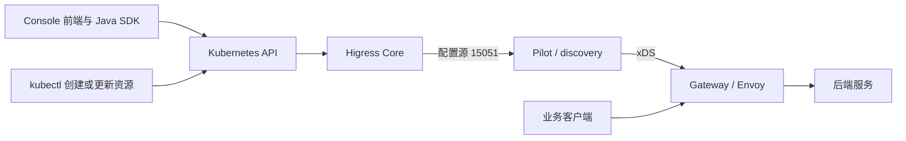

---
 我是网关开发者，是一位 higress 小白，但是下个月要接管上线 higress，我要如何学习 higress、是否要深入学习 istio 和 envoy。请给出学习 task 和优先级

---

# Higress 接管上线：学习任务 + 优先级路线图（面向**有后端 / 网关基础、即将生产接管、时间窗口≈1 个月**，小白视角，目标：**能稳定运维 + 排障，不盲目深挖理论**）

>
> 先给最关键的结论（直接回答你核心疑问）：
> ✅ **必须懂 Envoy，但不用做到 “Envoy 源码贡献者”；**
> ⚠️ **Istio：先学 Higress 使用的子集。** Higress 使用并扩展了 Istio/Pilot 的配置生成和 xDS 下发能力，不必先学习完整的 sidecar 服务网格，但不能把 Pilot 排除在学习范围之外。
>
> Higress 是基于 Envoy 的云原生网关。在本文对应的 Kubernetes 部署中，控制面由 **Higress Core + Pilot/discovery** 协作组成，通常同处 `higress-controller` Pod；Gateway 运行 agent 和 Envoy。无需额外安装完整 Istio，不代表 Higress 没有使用 Pilot。

> 修订说明：依据本地 `higress/helm/core/templates/controller-deployment.yaml` 和 [本地开发与全链路调试](../../higress/docs/walmart/local-development-debugging.md) 修正架构表述。具体资源支持和启动方式以实际部署版本、Chart 开关及 CRD 为准。

>
> 目标定义（1 个月，生产接管合格标准）：
>
>
> - 能看懂 Higress 的部署结构、CRD、配置流程；
> - 能独立做常见变更、灰度、限流、WAF、监控、证书；
> - 能通过日志 / 监控 /envoy admin 定位 80% 日常故障；
> - **不需要：通读 Envoy 全源码、精通 Istio 服务网格内部协议、自己扩展 Envoy Filter（这些是 P2 长期任务）**。

下面按 **P0（必须，前 1–2 周）> P1（重要，第 2–3 周）> P2（进阶，第 3–4 周，可选深入）> P3（长线，上线后再慢慢学）**，给出可执行 Task、检查点、避坑点、资源。

>
> 前置基础假设：你懂 K8s 基础（Pod/Deployment/Service/Ingress/ConfigMap/Secret、kubectl、helm）、了解反向代理、七层网关基础概念；如果 K8s 还不熟，先抽 0.5 周补 K8s。

---

## 📌整体学习路径概览

`K8s入口网关基础 → Higress整体架构&部署 → CRD与配置模型（核心） → Envoy必要知识（数据面） → 可观测&排障 → 业务场景落地 → [可选] Istio兼容细节 & Envoy深度`

>
> 重要原则：**先 “从 Higress 视角学 Envoy/Istio”，不要反过来：不要先学完整 Istio 再回来看 Higress；不要先啃 Envoy 官方大文档再碰 Higress。**

---

# P0｜紧急必学（第 1–2 周，优先级最高，上线保命，必须全部完成 ✅）

>
> 目标：知道 Higress“什么组件、怎么跑、配置怎么生效、流量怎么走、基础操作”；**先建立完整的宏观心智模型，再碰细节**
> 官方主站：[https://higress.io/](https://higress.io/) ；官方文档优先于任何博客；GitHub：[https://github.com/alibaba/higress](https://github.com/alibaba/higress)

### Task0‑1：搞懂 Higress 整体架构（2–3h）

**学习内容：**

- 控制面：`higress-controller` Deployment 通常包含 Core 和 `discovery`（Pilot）两个容器。
  - **Core**：监听 Ingress、McpBridge、WasmPlugin 等资源，将入口路由、服务发现和插件配置转换成内部配置。
  - **Pilot/discovery**：消费配置源，生成 LDS/RDS/CDS/EDS 等 xDS 资源，并向 Gateway 下发；还可能直接监听相关 Kubernetes 资源。
- 数据面：`higress-gateway` 中的 agent 负责 Envoy 启动及相关配置工作，Envoy 处理实际业务流量。Envoy 有启动用的 bootstrap 配置，路由等运行配置主要通过 xDS 动态获取，不能理解成“完全没有本地配置”。
- 管理面：`higress-console` 包含前端、Java 后端和 SDK，负责查询及写入 Kubernetes 资源，部分服务查询访问 Pilot 的 `15014` 端口。它不是单纯的 UI，也不位于业务请求转发路径上。
- 不要求安装完整 Istio 或给业务 Pod 注入 sidecar；TLS、证书与服务网格能力需结合实际配置理解，不假定存在独立的 `higress-cert-agent` 组件。

**检查点：**

能分别画出配置链路和业务链路：



- Core 负责入口配置转换，Pilot 负责 xDS 生成和下发，Gateway 负责实际转发；Console 保存成功不等于 Envoy 已接受新配置。
- 集群里没有名为 `istiod` 的 Deployment，不代表没有 Pilot；查看 `higress-controller` 的容器和镜像确认实际组成。

**学习范围：**先了解 Pilot 的配置源、xDS 推送和 ACK/NACK；深入调试时再读对应源码，无需先通读完整 Istio。

---

### Task0‑2：本地 / Minikube 快速部署一套可玩的 Higress（4–6h，动手！不要只看文档）

**学习内容：**

- 使用官方 Helm chart 在 minikube 或测试 K8s 集群部署最新稳定版 Higress；**不要自己拼凑 yaml**；
命令参考（官方）：
```
helm repo add higress.io https://higress.io/helm-charts
helm install higress higress.io/higress --namespace higress-system --create-namespace
```
- 观察启动后的 Pod：`higress-controller-xxx`、`higress-gateway-xxx`、可选 console；
- 学会基础运维命令：
```
# 看控制面日志（排障第一入口！！）
# 先确认真实容器名，再分别查看 Core 与 Pilot 日志
kubectl -n higress-system get deploy higress-controller \
  -o jsonpath='{.spec.template.spec.containers[*].name}{"\n"}'
kubectl logs -n higress-system deploy/higress-controller -c higress-core -f
# 在另一终端查看；若实际名称不同，替换上面的 higress-core
kubectl logs -n higress-system deploy/higress-controller -c discovery -f
# 看Envoy(gateway)日志
kubectl logs -n higress-system deploy/higress-gateway -f
# 进入gateway Pod打开Envoy Admin管理接口（非常关键！）
kubectl exec -it -n higress-system deploy/higress-gateway -- curl 127.0.0.1:15000/config_dump
```

>
> 💡 **15000 端口 Envoy Admin，是你以后排障最核心工具；必须现在就认识它；生产环境注意：Admin 端口不要对外暴露，只能内网运维访问。**

**检查点：**

- 部署成功；可以通过 Console 创建 Ingress 路由，把一条 host+path 流量转发到测试服务；**能从外部访问通**。
- 能区分 Kubernetes Ingress、Kubernetes Gateway API 与 Istio 配置模型；当前先沿用本地 Console 的 Ingress 路线。

>
> 📌这里只需要**会用**CRD；原理放到下一个任务。

---

### Task0‑3：吃透 Higress 配置模型 & 核心 CRD（8–12h；**整个学习周期最重的 P0 任务**）

>
> 先区分用户提交的资源与控制面内部配置，不把 Kubernetes Gateway API 和 Istio API 混为一套规范。
>
> - 本地 Console 学习主线：`Ingress` 及注解、`McpBridge` 服务发现、`WasmPlugin` 插件配置，以及 `Service`、`Secret`、`ConfigMap`。
> - Kubernetes Gateway API：`GatewayClass`、`Gateway`、`HTTPRoute` 等；先核对部署版本、CRD 和功能开关，不假定所有路由类型都支持。
> - Istio 配置模型：`VirtualService`、`DestinationRule` 等，用来理解 Core 到 Pilot 的配置转换。是否允许直接提交并生效，以部署配置为准；内部使用这些模型不等于用户必须创建对应 CR。
> - 不把 `HigressIngress`、`HigressWafRule`、`HigressGlobalRateLimit` 当作本环境已存在的标准资源；先用 `kubectl get crd` 核实。

**学习顺序：**

1. 先用 Console 创建 Ingress 路由，理解域名、路径、目标服务和注解；学习 McpBridge 与 WasmPlugin；
2. 再跟踪 Core 转换、Pilot 生成和 Envoy 接受配置；需要 Gateway API 时再按版本支持范围做实验；
3. 重点业务能力（生产高频）：
   - 域名、路径、header 匹配；URI 重写；超时、重试；
   - 流量灰度 / 按权重分流；**这个是网关最常变更的操作，必须亲手在测试环境跑通 Demo**；
   - 证书管理：TLS Secret、域名绑定及实际部署的证书管理机制；
   - 限流：**Higress 全局限流 vs Envoy 本地限流；区分清楚！**（很多新手混淆）；
   - WAF 基础：对应插件的规则、黑白名单及 WasmPlugin 配置；
   - McpBridge：对接外部服务注册中心（如果你们业务用到 Nacos，这块必须吃透；这是 Higress 非常高频的落地场景，**Istio 没有这个东西**）。

>
> ❗重要提醒：**不要去 Istio 文档里查 VirtualService 字段；Higress 有自己的支持矩阵，有些 Istio 字段不实现或行为不同，一切以 higress.io 文档为准！**

**检查点：**

- 在测试集群完整跑通：**一个域名 → 两条 HTTPRoute，80% 流量到 v1，20% 到 v2；配置 HTTPS 证书；加一个路径重写；设置连接 & 请求超时；配置一个 QPS 限流；**
- 修改一个路由，**观察 controller 日志确认配置被接受；再通过 envoy admin /config_dump 看到新规则已经推送到 Envoy**；完整走完「apply → Core 转换 → Pilot 下发 → Envoy 接受并生效」链路；

>
> ✨这个动作，是以后排查 “配置改了为什么不生效” 的标准流程，**必须亲手走一遍**。

---

### Task0‑4：Envoy **最小必要集**（6–8h；**不用读 Envoy 全书，精准只学 Higress 用到的部分；拒绝泛读**）

>
> 目标：**看得懂 Envoy 概念、看得懂 config_dump、听得懂排障术语，不是去开发 Envoy Filter。**
> 学习**只需要这些名词，按顺序：**
>
>
> - xDS 协议：LDS/RDS/CDS/EDS（只需要知道每个 DS 管什么：Listener、Route、Cluster、Endpoint；**不用自己实现 xDS 客户端**；只需要知道：**Core 转换入口配置，Pilot 生成这些 xDS 资源并推给 Envoy**）；
> - Listener（监听器：端口、TLS、FilterChain）；
> - RouteConfiguration（路由表，VirtualHost、Route 条目；**你在 CR 里写的 host/path，最终都会翻译成这里**）；
> - Cluster（后端集群，对应 Service；连接池、超时、健康检查、负载均衡策略）；
> - Endpoint（后端真实 Pod IP；EDS 动态下发）；
> - 核心 Filter 链：HTTP connection manager、HTTP filters 和 router；Higress 的鉴权、限流等扩展常通过 Wasm 插件实现，结合 WasmPlugin 与 ECDS 配置理解，不能笼统称为 Lua 封装；
> - **Admin 接口使用：/config_dump、/clusters、/listeners、/stats、/log**；**这 5 个 URL 是排障神器，必须每个都点开看，能读懂输出的大致结构**。

**禁止 P0 阶段做：**

- 通读 Envoy 所有配置字段；
- 学习如何自己写 C++ Envoy Filter；
- 深入研究 Lua 脚本开发（放到 P2）。

**检查点：**

>
> 修改完一条 HTTPRoute 后，去 `15000/config_dump`，**能在 RDS 部分找到你配置的域名、路径、重写规则；在 CDS 找到对应的后端 Cluster；确认配置已经下发成功。**

>
> 💡一句话：**CR 是 “面向业务的声明语言”；Envoy config_dump 是 “数据面最终落地的事实真相”；只要 config_dump 里没有，配置就没有真正生效。**

---

>
> 🎯 **P0 完成标志（2 周左右）：**
> 可以独立在测试集群完成：**域名接入、HTTPS、路由、灰度、限流、证书；并且能通过 controller 日志 + envoy admin，确认配置是否下发；知道流量在网关内部从 Listener→Route→Cluster→Endpoint 怎么走。**

---

# P1｜重要，上线前必须掌握（第 2–3 周；生产稳定性、可观测、运维 & 风险；**Istio 学习被放在这里的很小一块**）

>
> 目标：从 “能配置” 升级到**敢接管线上，知道怎么监控、怎么回滚、常见故障长什么样、边界条件**

### Task1‑1：完整学习 Higress 的可观测体系（4–6h）

- 内置指标：Prometheus Metrics（higress‑controller 指标 + Envoy 原生 stats 指标）；**Higress 已经把大部分常用指标做好，不用自己拼凑 relabel（你之前问过 Prometheus 采集 Higress Pod！官方有完整 grafana dashboard 可以直接导入）**；
- 访问日志：Access Log 格式、字段含义；怎么开启自定义日志；日志里的响应码、upstream_code、upstream_host、x‑envoy‑* 系列 header；**非常关键，区分网关侧错误（503/504 来自 Envoy）还是业务后端错误**；
- 链路追踪：OTel 接入（Higress 支持把 trace 传到 Jaeger 等；知道开关位置即可，不用从零实现）；
- 官方 Grafana 看板导入，看懂大盘：流量、错误率、延迟、上游健康状态；

**检查点：**在测试环境，**能复现一个 503，通过访问日志和 metrics 定位：是没有可用 Endpoint、还是后端拒绝连接、还是健康检查失败**。

### Task1‑2：生产运维、变更流程、回滚、高可用（4h）

- Higress 控制面：分别理解 Core 与 Pilot 的多副本行为。不能把整个 Controller 笼统描述为“只有 leader 能推 xDS”；部分任务使用 leader 选举不等于所有配置生成和 xDS 服务都为主备。检查实际副本、Gateway 的 xDS 连接、滚动更新和故障重连表现；
- higress‑gateway（Envoy）：**无状态，可以水平扩缩容；多 Pod 之间没有共享状态；全局限流是 “通过外部 Redis”，不是 Envoy 本地，这点要区分**；
- 变更最佳实践：**先在测试验证 CR；生产用 GitOps 管理 yaml；每次变更只改一条规则；变更前后检查 controller 日志 + envoy config_dump；准备好 “kubectl delete” 快速回滚方案；严禁直接操作 Envoy 静态配置！**
- 健康检查、就绪探针、启动顺序；滚动更新时流量丢失风险；

### Task1‑3：**有选择地 “蹭一点 Istio 知识，不要系统学习”（3–4h，严格限定范围！）**

>
> **只学这些，超出范围全部延后到 P3：**
>
>
> 1. 为什么 Higress 选择兼容 Istio 的 VirtualService/DestinationRule API；
> 2. 这些 CRD**原始定义在哪里（istio/api 仓库）**；知道它只是一个 “proto 定义”，**不等于要运行 Istio 软件**；
> 3. **只看概念：什么是 mTLS；什么是 DestinationRule 里的 TLS 设置；Higress 如何支持网关到后端的单向 / 双向 TLS；**
>
>
> ❌ **P1 不要去学：Istio sidecar 注入、AuthorizationPolicy 完整网格策略、Citadel、 istiod 内部推送队列、流量镜像完整网格方案、Kiali、Jaeger 在 Istio 里的全套部署。这些和 Higress 入口网关职责几乎无关，投入产出极低。**

**检查点：**能回答：**“我的集群里没有 istiod，为什么还能 apply VirtualService？”—— 因为 CRD 只是 K8s 自定义资源定义，**API Server 安装对应 CRD 后才能接收资源；资源生效还依赖控制面实际监听和支持。Higress 自带 Pilot/discovery，因此无需另装完整 Istio，但不能据此说没有使用 Istio 组件。**

### Task1‑4：高频故障案例学习 & 排障 SOP（4–6h；刷官方 FAQ + GitHub issues + 公开落地文章）

建立标准化排查顺序（背下来）：

>
> 1. kubectl apply 有没有语法错误？ → kubectl get events 看 K8s 事件；
> 2. higress‑controller 日志：有没有 “解析 CR 失败、校验失败、丢弃配置”；**很多配置不生效是在这里被拒绝，用户却不知道；**
> 3. 确认 Core 转换与 Pilot 推送正常，检查 ACK/NACK → Envoy admin `/config_dump` 检查有效的 RDS/CDS 配置，不能把失败配置或 warming 配置当作已生效；
> 4. 如果配置已经在 Envoy 里：看访问日志、envoy `/stats` 指标，定位是路由没匹配到、还是上游问题；
> 5. 网络层：安全组、service、后端 Pod 连通性。

>
> 重点熟悉高频坑：
>
>
> - xDS 推送延迟；大配置下 controller 内存；
> - McpBridge 对接 Nacos 时，服务列表同步异常；
> - 重写规则、header 操作顺序问题；
> - 健康检查配置不生效，Envoy 把正常后端判定不健康；
> - 证书 Secret 更新不自动生效；

---

>
> 🎯 **P1 完成标志：**你已经有了一份自己的「Higress 上线检查清单 + 故障排查 SOP」；清楚系统薄弱点；知道监控看什么；变更如何安全执行。

---

# P2｜进阶深挖（第 3–4 周，上线前有余力就做；**非强制，但能显著提升兜底能力**）

>
> 目标：解决复杂业务场景，开始适度深入 Envoy；仍然**不需要啃 Istio 完整体系**

- Task2‑1：Envoy 进阶：理解连接池配置、负载均衡策略、健康检查参数、circuit‑breaker（熔断）；看懂 Envoy stats 里各种`*_circuit_breakers_*`指标；**通过 DestinationRule 调整这些参数，而不是手写 Envoy 配置**；
- Task2‑2：Higress 扩展：Lua 插件开发（官方封装好的 Higress LuaFilter，**只学 Higress 提供的 API，不要直接裸写复杂 Envoy Lua**；适合自定义 header、简单鉴权；生产尽量少写自定义 Lua，维护成本高）；
- Task2‑3：自定义 AccessLog、高级 WAF 规则、外部鉴权（ExtAuth）对接；
- Task2‑4：学习 Higress 灰度升级方案、如何做版本回滚；了解 helm values 里关键参数含义；
- Task2‑5：**可选小范围：了解 Istio Gateway API 生态社区；只作为视野拓展，不作为运维必备。**

---

# P3｜长期学习（**上线稳定后，不用现在花时间；按兴趣按需点开**）

这些属于 “专家路线”，不是接管上线刚需：

- Envoy 源码阅读、C++ Filter 开发；
- 完整学习 Istio 服务网格，如果未来业务有 sidecar 网格规划；
- xDS 协议深度、控制面设计模式；
- Higress 二次开发，自己扩展 Controller。

>
> ⚠️一个很重要的心理建设：**很多人以为 “用好 Higress = 精通 Istio+Envoy”；现实是，对于入口网关运维，Envoy 懂必要的数据面概念足够；Istio 先掌握相关 API、Pilot 配置生成及 xDS 下发，不需要吃透完整服务网格实现。把宝贵的一个月，优先砸在 Higress 自身、K8s、可观测、真实生产场景上。**

---

## 📚精选资源清单（只给高效、官方优先，拒绝大海捞针）

1. **官方文档（第一位）**：[https://higress.io/docs/latest/](https://higress.io/docs/latest/)
2. Higress GitHub Wiki & Discussions：[https://github.com/alibaba/higress](https://github.com/alibaba/higress)
3. Envoy 只看这几页，不要全看：
   - [https://www.envoyproxy.io/docs/envoy/latest/intro/arch_overview/configuration/xds](https://www.envoyproxy.io/docs/envoy/latest/intro/arch_overview/configuration/xds)
   - [https://www.envoyproxy.io/docs/envoy/latest/intro/arch_overview/http/http_connection_management](https://www.envoyproxy.io/docs/envoy/latest/intro/arch_overview/http/http_connection_management)
   - Admin 接口文档：[https://www.envoyproxy.io/docs/envoy/latest/operations/admin](https://www.envoyproxy.io/docs/envoy/latest/operations/admin)
4. Gateway API 官方：[https://gateway-api.sigs.k8s.io/](https://gateway-api.sigs.k8s.io/)
5. Istio API（先看配置定义，需要调试时再阅读 Higress 使用的 Pilot 实现）：[https://github.com/istio/api](https://github.com/istio/api)

>
> ❌ 不推荐：上来就买《Istio 服务网格权威指南》这类厚书；**对你当前目标严重超纲，性价比很低**。

---

如果你需要，我可以下一步给你一份**7 天的每日细化学习计划 + Higress 上线检查清单（可直接打印用于接管评审）**。
